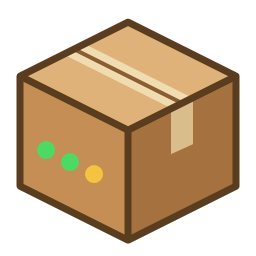

<p align="center"></p>

<h1 align="center">CardboardBox</h1>

<p align="center"><b>The simplest way to run a Minecraft server on Windows.</b><br>
One small <code>.exe</code>. No installs, no command line, no port-forwarding guides (well, mostly).</p>

---

## For the person running the server

1. Download **`CardboardBox.exe`** from the [latest release](../../releases/latest).
2. Double-click it. If Windows says *"Windows protected your PC"*, click **More info**, then **Run anyway**.
   (This shows up for any new program that isn't from a big company.)
3. Wait for it to finish setting up (the first time it downloads Java and Minecraft, about 120 MB).
4. Press **Start server** and agree to the Minecraft EULA. If Windows asks about
   **"OpenJDK Platform binary"**, click **Allow** (that's the Minecraft server; friends can't connect without it). Done!

Friends on the same Wi-Fi join using the **Home network address** shown on the Dashboard.
Friends elsewhere use the **Internet address**. Try the **Auto port-forward** link first. If your router
doesn't allow it, forward port `25565` (TCP) to this PC in the router settings, or use a free tunnel like [playit.gg](https://playit.gg).

Everything lives in `C:\Users\<you>\CardboardBox`. The Dashboard has a button to open that folder.

### What's in the app

| Page | What it does |
|---|---|
| **Dashboard** | Start / Stop / Restart, players online, CPU and RAM (with live charts), uptime, Minecraft version, server addresses, GitHub sync status, a message from the server owner |
| **Console** | Live server log, a box to type commands, and quick buttons (who's online, save, TPS, plugins) |
| **Server Settings** | Server message (MOTD) with a live preview, server icon (any picture, auto-resized), max players, RAM slider, difficulty, game mode, port, whitelist, and auto-restart/backup options |
| **Plugins** | See every plugin, add `.jar` files, turn plugins on/off, remove them, or upload them to GitHub |
| **Players** | Online / operators / whitelist / banned lists, plus one-click op, kick, ban, whitelist |
| **Backups** | Back up the world (even while it's running), restore, and keep the newest *N* backups |
| **GitHub** | Sync status, check now, change the check interval, optional upload token, app updates |

### It looks after itself

- **Installs everything.** It gets Java (Eclipse Temurin), the Paper server and plugins by itself, checking every download against its checksum.
- **Checks GitHub every hour.** If this repo changed, it downloads the new files. If the server is running, it warns players in-game, makes a backup and restarts (you can turn this off).
- **Crash recovery.** If the server crashes it restarts automatically, up to 3 times in 10 minutes.
- **Plain-English errors.** Common problems (port already in use, not enough RAM, wrong Java, a broken plugin, no internet) are explained on screen.
- **Works offline.** If GitHub can't be reached, it starts with the files from last time.
- **Never leaves a zombie server.** If CardboardBox is closed or crashes, Java is shut down with it, and the PC won't go to sleep while the server is running.
- **Updates itself.** When a new release is published here, the app offers a one-click update.

---

## For the server owner (you, editing this repo)

This repo is the **source of truth**. Every CardboardBox that points at it copies these files:

```
cardboardbox.json        <- what to install (Minecraft version, RAM, plugins, announcement)
server/                  <- copied into the server folder on every PC
  server.properties      <- base settings (merged key by key, see below)
  server-icon.png        <- 64x64 server icon
  plugins/               <- drop plugin .jar files (and their config folders) here
  ...anything else       <- bukkit.yml, paper configs, datapacks, etc.
app/                     <- the CardboardBox source code (C#)
```

Edit files on github.com (or push with git). Within an hour every server picks up the change.
To push a change immediately, your friend can press **Check GitHub now**.

### `cardboardbox.json`

```jsonc
{
  "serverName": "CardboardBox",        // name shown in the app's MOTD preview
  "minecraftVersion": "26.3",          // a Paper version, or "latest"
  "paperBuild": 0,                     // 0 = newest stable Paper build for that version
  "javaVersion": 0,                    // 0 = automatic (whatever Paper says it needs)
  "defaultRamGB": 4,                   // capped to what the PC can spare
  "announcement": "Hi!",               // shown on everyone's Dashboard
  "extraJvmFlags": [],                 // extra Java flags, if you know you need them
  "plugins": [
    "luckperms",                                  // Modrinth project name: right version picked automatically
    { "modrinth": "chunky" },                     // same thing, long form
    { "url": "https://example.com/Thing.jar",     // any direct download link
      "file": "Thing.jar", "sha256": "optional" }
  ]
}
```

Plugins listed here are downloaded by each PC, so you don't need to commit big `.jar` files.
If a plugin has no version for your Minecraft version, it's skipped with a warning and the server still starts.
Remove a plugin from the list and it's removed from every server.

### How syncing works (the important rules)

- A file that's in the repo but missing on the PC is **copied in**.
- A file you **changed** in the repo **overwrites** the PC's copy.
- A file you **didn't** change in the repo is **left alone**, so plugins can keep editing their own configs.
- A file you **delete** from the repo is **deleted** on every PC.
- `server.properties` is merged **key by key**: your keys win, Minecraft keeps the rest.
  Settings the friend changes in the app are layered on top (shown as "differ from GitHub" in the app,
  with a button to reset them).
- Worlds, `eula.txt`, player lists and dot-files are **never** touched by syncing.

### Letting the friend upload changes (optional)

Downloading never needs an account. If you want the friend to be able to upload settings or plugins
from the app, make a [fine-grained token](https://github.com/settings/personal-access-tokens/new)
limited to this repo with **Contents: Read and write**, and paste it on the app's GitHub page.
It's stored encrypted with Windows' DPAPI for that Windows user only.

### Releasing a new version of the app

```powershell
git tag v1.0.1
git push origin v1.0.1
```

GitHub Actions builds `CardboardBox.exe` and attaches it to a release. Every running copy then offers the update.
To build locally instead: `powershell -ExecutionPolicy Bypass -File build.ps1` (output in `dist\`).
It needs the .NET SDK. The exe itself targets .NET Framework 4.8, which comes with every Windows 10/11 PC.

---

## Troubleshooting

| Problem | Fix |
|---|---|
| "Port 25565 is already in use" | Another server is running. Close it, check Task Manager for `java.exe`, or change the port in Server Settings. |
| Friends outside the house can't join | Port forwarding. Try **Auto port-forward**, forward TCP 25565 in the router, or use playit.gg. |
| Server crashes with "ran out of memory" | Raise RAM in Server Settings, or remove heavy plugins. |
| Something else | Open the **Console** page. The full log is in `C:\Users\<you>\CardboardBox\logs`. |

Advanced: set the environment variable `CARDBOARDBOX_HOME` to keep CardboardBox's files somewhere else.

*Minecraft is a trademark of Mojang AB. CardboardBox is not affiliated with Mojang or Microsoft.
Paper is made by the [PaperMC](https://papermc.io) team, and Java builds come from [Eclipse Adoptium](https://adoptium.net).*
